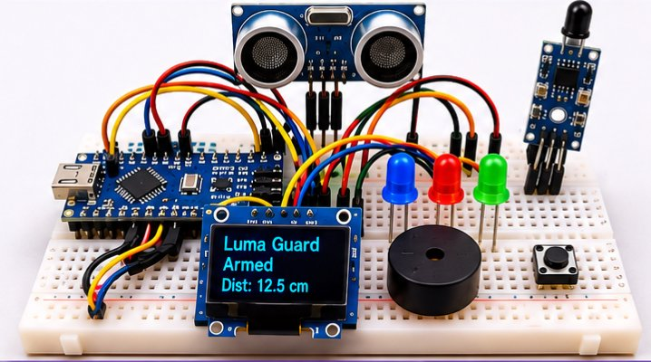
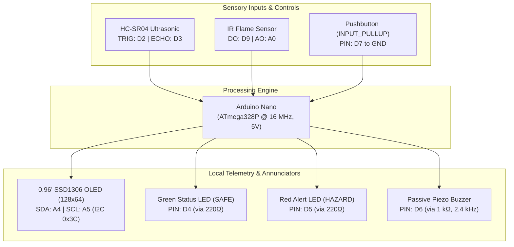
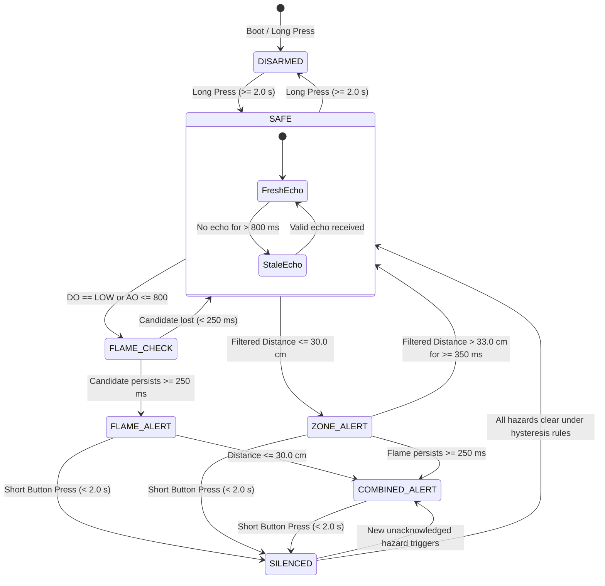

# LumaGuard — Context-Aware Micro-Workspace Hazard & Proximity Guard

[](https://platformio.org/)
[](https://store.arduino.cc/products/arduino-nano)
[](docs/test_report.md)
[](LICENSE)
[](docs/test_report.md)

An embedded safety and work-zone proximity monitoring prototype built on the **Arduino Nano (ATmega328P)**. LumaGuard improves upon simplistic sensor-to-buzzer threshold circuits by integrating multi-channel sensory arbitration, temporal candidate persistence, hysteresis boundaries, variable-cadence audible annunciation, local OLED telemetry, and non-volatile event logging.

---

## Physical Hardware Prototype


*Figure 1: Fully integrated, bench-tested physical prototype assembled on an 830-point solderless breadboard, featuring the Arduino Nano (left), 0.96" SSD1306 OLED (bottom center), HC-SR04 ultrasonic transducer (top center), IR optical flame module (top right), indicator LEDs, piezo buzzer, and tactical control pushbutton.*

---

## 1. Problem Statement & Engineering Motivation

Basic hobbyist safety circuits connect a sensor comparator directly to an annunciator or buzzer. In practical workshop environments, this naive approach produces:
1. **Transient False Alarms**: Momentary optical flashes (camera flashes, lighter sparks, lighting flicker) cause nuisance alarms.
2. **Threshold Flapping / Chatter**: An object wavering near a single trip boundary repeatedly turns outputs on and off at high frequency.
3. **Ambiguous System States**: Operators cannot distinguish whether a system is actively checking a transient, sounding an unacknowledged emergency, silenced by an operator, or suffering from a disconnected/stale sensor.

**LumaGuard resolves these challenges at the embedded firmware level** by implementing:
- **Temporal Persistence**: Optical candidates must persist continuously for $\ge 250\text{ ms}$ before confirming a flame hazard.
- **Bi-Level Hysteresis**: Proximity danger trips at $\le 30.0\text{ cm}$, but clears only when distance exceeds $33.0\text{ cm}$ for $\ge 350\text{ ms}$.
- **Proportional Audible Urgency**: Buzzer beep repetition period accelerates from $900\text{ ms}$ down to $180\text{ ms}$ as an intruder moves from $30\text{ cm}$ to $2\text{ cm}$.
- **Two-Tiered Single-Button Control**: Short press (< 2.0 s) silences audio while preserving visual status; Long press ($\ge 2.0\text{ s}$) toggles ARMED / DISARMED.
- **Graceful Fault Detection**: Missing ultrasonic echoes are flagged as `NO ECHO` / `ZONE UNKNOWN` after $800\text{ ms}$, preventing stale values from being mistaken for a clear zone.

---

## 2. Hardware Architecture & Pin Mapping



### Complete Signal & Electrical Pinout
| Component / Module | Module Pin | Arduino Nano Pin | Function / Type | Electrical Characteristics |
| :--- | :---: | :---: | :--- | :--- |
| **HC-SR04 Ultrasonic** | `TRIG` | `D2` | Digital Output | 10 µs trigger pulse (5V TTL) |
| **HC-SR04 Ultrasonic** | `ECHO` | `D3` | Digital Input | Bounded echo duration read (25 ms timeout) |
| **Green Status LED** | `ANODE` | `D4` | Digital Output | Active HIGH (SAFE status; requires fresh echo) |
| **Red Alert LED** | `ANODE` | `D5` | Digital Output | Active HIGH (Hazard active or silenced) |
| **Piezo Buzzer** | `POS (+)` | `D6` | Digital Output | 2.4 kHz tone bursts (80 ms ON time, variable period) |
| **Tactile Pushbutton** | `SWITCH` | `D7` | Digital Input | Active LOW (`INPUT_PULLUP`, 35 ms debounce) |
| **IR Flame Module** | `DO` | `D9` | Digital Input | Active LOW comparator output (Optical candidate trigger) |
| **IR Flame Module** | `AO` | `A0` | Analog Input | 10-bit ADC (Trigger: $\le 800$, Clear: $\ge 850$) |
| **SSD1306 OLED Display**| `SDA` | `A4` | Hardware I2C | Serial Data line (I2C address: `0x3C`) |
| **SSD1306 OLED Display**| `SCL` | `A5` | Hardware I2C | Serial Clock line (100 kHz standard mode) |
| **Power Rails** | `5V` / `GND`| `5V` / `GND`| Power Supply | Regulated 5.0 V DC (approx. 90 mA nominal consumption) |
| **DHT22 Sensor** | — | — | **EXCLUDED** | Tested during prototyping; excluded from final build |

---

## 3. Firmware Architecture & State Machine

The firmware uses a non-blocking cooperative scheduling executive driven by `millis()` comparisons, avoiding monolithic `delay()` calls:



### Key Mathematical Decision Parameters
- **Distance Filter**: Exponential Moving Average: $\text{dist} = 0.60 \times \text{prev} + 0.40 \times \text{raw}$.
- **Zone Thresholds**: Entry $\le 30.0\text{ cm}$; Exit $> 33.0\text{ cm}$ held for $350\text{ ms}$.
- **Flame Persistence**: Candidate held for $250\text{ ms}$ before confirmation; Clear requires $\text{AO} \ge 850$ and $\text{DO} = \text{HIGH}$ for $1,200\text{ ms}$.
- **Buzzer Tone**: $2,400\text{ Hz}$ tone with $80\text{ ms}$ pulse width. Beep period scales linearly from $900\text{ ms}$ down to $180\text{ ms}$ based on urgency.
- **EEPROM Telemetry**: Address `0x0000` stores magic signature `0xF17E` and a 32-bit counter (`hazardStarts`) tracking lifetime hazard activations.

---

## 4. Verification Protocol & Results

The physical prototype was evaluated on a test bench through nine end-to-end integration scenarios:

| Test ID | Scenario Tested | Stimulus & Condition | Observed Functional Result | Status |
| :-: | :--- | :--- | :--- | :-: |
| **IT-01** | **Armed Nominal** | Target at 50 cm (>33 cm), no flame stimulus. | Green LED ON; OLED shows `ALERT: SAFE` with live distance; audio off. | **PASS** |
| **IT-02** | **Zone Intrusion** | Target moved to 20 cm ($\le 30\text{ cm}$). | Red LED ON; Buzzer pulses with cadence accelerating as target nears; OLED shows `ZONE ALERT`. | **PASS** |
| **IT-03** | **Flame Confirmation** | Optical flame stimulus applied $\ge 250\text{ ms}$. | Transient rejected as `FLAME CHECK`; confirmed after 250 ms hold; Red LED ON; audio alerts. | **PASS** |
| **IT-04** | **Dual Hazard** | Target at 15 cm AND flame source active. | OLED displays `FLAME + ZONE`; buzzer automatically selects faster cadence. | **PASS** |
| **IT-05** | **Alert Silence** | Short press (< 2.0 s) during active alarm. | Buzzer instantly mutes; Red LED remains ON; OLED displays `ALERT: SILENCED`. | **PASS** |
| **IT-06** | **Disarm / Arm** | Long press ($\ge 2.0\text{ s}$) on button. | Actuators force-muted; OLED displays `DISARMED`; long press again restores `ARMED`. | **PASS** |
| **IT-07** | **Hysteresis Clear** | Target moved past 33 cm; flame extinguished. | Zone holds 350 ms; flame holds 1,200 ms; system returns cleanly to `ALERT: SAFE`. | **PASS** |
| **IT-08** | **Echo Timeout** | Echo path blocked / free air aim (> 400 cm). | After 800 ms, OLED shows `NO ECHO` and `ZONE UNKNOWN`; Green LED turns OFF. | **PASS** |
| **IT-09** | **EEPROM Persistence** | Trigger new hazard, observe count, power-cycle. | Newly active hazard increments counter; value restored from EEPROM upon reboot. | **PASS** |

---

## 5. Build & Compilation Verification

The firmware compiles deterministically using **PlatformIO Core**:

```bash
pio run -e nanoatmega328
```

### Compiler Memory Utilization (ATmega328P @ 16 MHz)
- **RAM Usage**: `729 bytes` / `2,048 bytes` (**35.6%** used, leaving 1,319 bytes for dynamic stack depth).
- **Flash Usage**: `21,660 bytes` / `30,720 bytes` (**70.5%** used, including Adafruit GFX primitives and SSD1306 framebuffer).
- **Compilation Output**: `[SUCCESS]` with zero errors or warnings.

---

## 6. Safety Disclaimers & Design Boundaries

> [!CAUTION]
> **Educational Prototype Classification**:
> - LumaGuard is an academic engineering demonstrator developed for laboratory workbenches.
> - It is **NOT** a certified commercial fire alarm or industrial safety instrument (e.g. UL 268, EN 54, or NFPA 72 compliance).
> - It must not be deployed as an autonomous life-safety protection system without secondary certified emergency equipment.
> - **DHT22 Exclusion**: The single-wire DHT22 sensor was tested during early development, failed data-read reliability tests, and was explicitly removed from the production circuit and firmware.

---

## 7. Project Lineage & Academic Attribution

- **Institution**: S.A. Engineering College (Autonomous, Affiliated to Anna University), Chennai, India.
- **Department**: Department of Electronics and Communication Engineering.
- **Project Type**: ECE Mini Project Report (November 2026).
- **Project Team**:
  - **Ronald Rex C H** ([@RONALD-REX-7](https://github.com/RONALD-REX-7)) — Embedded Firmware Architecture, State Machine, PlatformIO Build Automation.
  - **Rahul P** — Hardware Assembly, Sensor Interfacing & Breadboard Integration.
  - **Rudra Kumar M** — Circuit Prototyping, Bench Testing & Electrical Documentation.
- **Project Supervisors**: Ms. G. Vasumathi, M.E. (Assistant Professor) & Dr. B.R. Tapas Bapu, M.E., Ph.D. (Professor & HOD).
- **Privacy Standard**: Student register numbers and private contact details are quarantined from all public documentation.

---

## 8. License

This project is licensed under the [MIT License](LICENSE) — see the LICENSE file for details.
