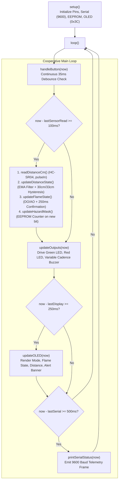
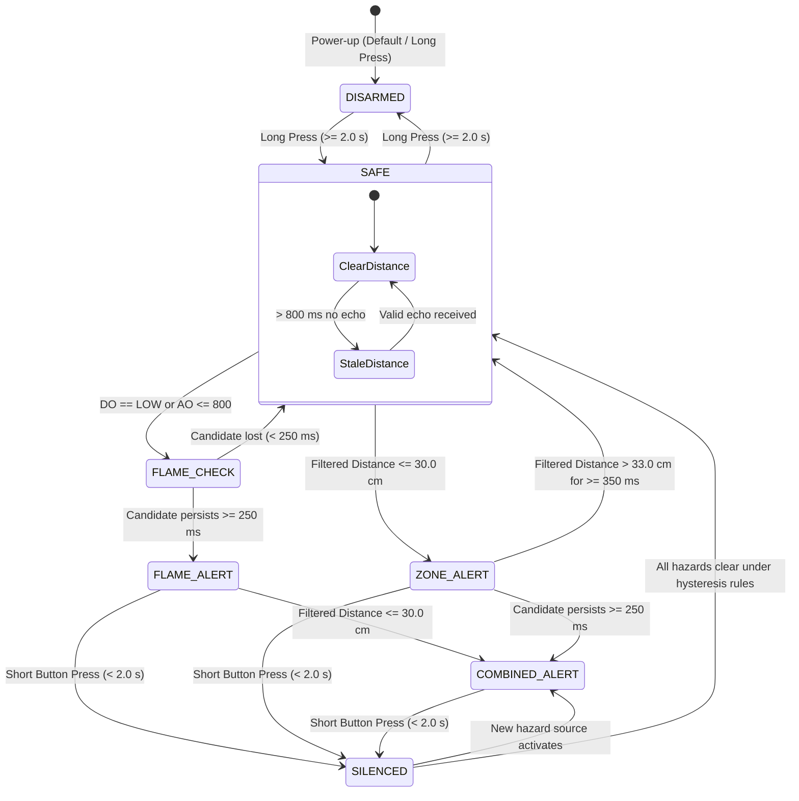

# LumaGuard — Firmware Architecture & Operating State Machine

**Microcontroller:** Microchip / Atmel ATmega328P (8-bit AVR, 16 MHz, 2 KB SRAM, 32 KB Flash)  
**Execution Model:** Non-preemptive cooperative state scheduling via `millis()`  
**Framework:** Arduino Core (C++11)

---

## 1. System Architecture Overview

LumaGuard executes a deterministic, multi-rate cooperative scheduling loop that decouples sensor acquisition, filter stabilization, decision logic, display refresh, and audible annunciation.



---

## 2. Finite State Machine & Operational State Transitions

The system avoids monolithic enumerated flags by computing user-facing alert states dynamically from a **Hazard Bitmask** (`activeHazardMask`), a **Silence Bitmask** (`silencedHazardMask`), an **Armed Flag** (`armed`), and an **Echo Freshness Timer** (`lastValidDistanceMs`).



---

## 3. Mathematical Decision Parameters & Transfer Equations

### 3.1 Ultrasonic Signal Processing & Hysteresis
1. **Exponential Moving Average (EMA) Distance Filter**:
   $$\text{dist}_{\text{filtered}} = 0.60 \times \text{dist}_{\text{prev}} + 0.40 \times \text{dist}_{\text{raw}}$$
   - Prevents momentary air turbulence or acoustic noise spikes from falsely triggering alerts.
2. **Zone Trigger & Clear Boundaries**:
   - **Entry Boundary**: $\text{dist}_{\text{filtered}} \le 30.0\text{ cm}$ $\rightarrow$ Sets `distanceDanger = true`.
   - **Clear Boundary**: $\text{dist}_{\text{filtered}} > 33.0\text{ cm}$ sustained continuously for $\ge 350\text{ ms}$ $\rightarrow$ Clears `distanceDanger = false`.
   - **Hysteresis Band**: $3.0\text{ cm}$ deadband prevents rapid chatter at threshold crossings.
3. **Echo Timeout & Stale Data Management**:
   - `pulseIn()` duration measured with $25,000\text{ }\mu\text{s}$ timeout ($\approx 429\text{ cm}$).
   - If no valid echo pulse is received for $> 800\text{ ms}$, the display reports `NO ECHO` and the system marks `ZONE UNKNOWN`, turning off the Green Safe LED.
   - If an active zone hazard is present, it is held for $1,200\text{ ms}$ (`NO_ECHO_CLEAR_MS`) before being cleared due to echo loss.

---

### 3.2 Dual-Output Optical Flame Logic
1. **Candidate Detection**:
   - Triggers when `FLAME_DO == LOW` (comparator active) **OR** `FLAME_AO <= 800` (ADC code indicates optical infrared rise).
2. **Temporal Persistence Filter**:
   - A candidate must remain continuously active for $\ge 250\text{ ms}$ (`FLAME_CONFIRM_MS`) to become a confirmed hazard (`flameConfirmed = true`).
   - Rejects momentary optical flash noise (e.g. camera flash, lighter strike transient outside zone).
3. **Clear Hold Interval**:
   - Requires `FLAME_DO == HIGH` **AND** `FLAME_AO >= 850` continuously for $\ge 1,200\text{ ms}$ (`FLAME_CLEAR_HOLD_MS`) before clearing the confirmed hazard.

---

### 3.3 Proportional Audible Cadence Mapping
When a hazard is active and unacknowledged, the buzzer emits an $80\text{ ms}$ burst of $2,400\text{ Hz}$ square wave tone at a repetition period that scales inversely with urgency:

1. **Distance Urgency Cadence**:
   - Urgency ratio:
     $$u_d = \frac{30.0 - d}{30.0 - 2.0}, \quad \text{clamped to } [0.0, 1.0]$$
   - Beep Repetition Period:
     $$T_d = 900 - u_d \times (900 - 180)\text{ ms}$$
   - At $30\text{ cm}$, buzzer beeps slowly every $900\text{ ms}$. As target approaches $2\text{ cm}$, beep period accelerates linearly down to $180\text{ ms}$ (rapid urgency).
2. **Flame Intensity Urgency Cadence**:
   - Optical response ratio:
     $$u_f = \frac{1000 - \text{AO}}{1000 - 400}, \quad \text{clamped to } [0.0, 1.0]$$
   - Beep Repetition Period:
     $$T_f = 650 - u_f \times (650 - 180)\text{ ms}$$
3. **Multi-Hazard Selection**:
   - If both hazards are concurrently active, the firmware selects:
     $$T = \min(T_d, T_f)$$
     ensuring the most critical threat dictates audible priority.

---

## 4. Operator Interface & Single-Button State Machine

A single tactile momentary switch on `D7` provides full two-tiered control:
1. **Debounce Interval**: $35\text{ ms}$ stable input threshold.
2. **Short Press ($< 2.0\text{ s}$)**:
   - Sets `silencedHazardMask |= activeHazardMask`.
   - Instantly mutes the piezo buzzer (`stopBuzzer()`).
   - Retains hazard status visually on OLED (`SILENCED`) and keeps Red LED illuminated while hazard persists.
   - If a new, previously unacknowledged hazard triggers, its bit is not in the silence mask, re-sounding the buzzer.
3. **Long Press ($\ge 2.0\text{ s}$)**:
   - Toggles system between **ARMED** and **DISARMED**.
   - In **DISARMED** mode, all physical actuators (LEDs and buzzer) are forced OFF, while sensor measurement and serial diagnostics continue uninterrupted.

---

## 5. Non-Volatile EEPROM Logging

- Struct `PersistentEventLog` located at EEPROM address `0`:
  ```cpp
  struct PersistentEventLog {
      uint16_t signature;    // 0xF17E magic validation code
      uint32_t hazardStarts; // Lifetime cumulative newly active hazard events
  };
  ```
- Upon boot, `loadEventCounter()` verifies signature `0xF17E`. If uninitialized or corrupted, it formats the record to 0.
- When `newlyActive = newMask & (~activeHazardMask)` detects that a hazard bit has newly triggered, `eventLog.hazardStarts++` is committed to EEPROM.
- Surpasses power cycles without wear-leveling concerns due to low hazard event frequency.

