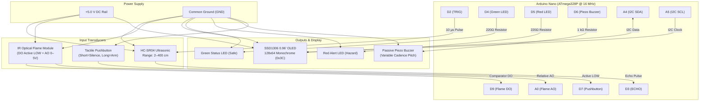

# LumaGuard — Pinout & Electrical Wiring Specification

**Target Hardware:** Arduino Nano (ATmega328P, 5V, 16 MHz)  
**Power Domain:** Single +5.0 V DC Rail (USB or external regulated bench supply)  
**Status Lifecycle:** Stage 4 (`Hardware bench tested`)

---

## 1. Complete Pin Mapping Table

| Component | Module Pin | Arduino Nano Pin | Electrical Function | Logic / Signal Level | Wiring Notes & Protection |
| :--- | :---: | :---: | :--- | :--- | :--- |
| **HC-SR04 Ultrasonic** | `VCC` | `5V` | System Power | 5.0 V DC (65 mA peak) | Connect directly to 5V rail |
| **HC-SR04 Ultrasonic** | `GND` | `GND` | Power Ground | 0 V Reference | Shared common ground |
| **HC-SR04 Ultrasonic** | `TRIG` | `D2` | Digital Output | 5.0 V TTL | 10 µs trigger pulse |
| **HC-SR04 Ultrasonic** | `ECHO` | `D3` | Digital Input | 5.0 V TTL | Bounded pulse read (25 ms timeout) |
| **Status Green LED** | `ANODE` | `D4` | Digital Output | 5.0 V Logic (Active HIGH) | In series with 220 Ω resistor to GND |
| **Status Red LED** | `ANODE` | `D5` | Digital Output | 5.0 V Logic (Active HIGH) | In series with 220 Ω resistor to GND |
| **Piezo Buzzer** | `POS (+)` | `D6` | Digital Output | PWM / Tone (Active HIGH) | In series with 1 kΩ resistor to GND |
| **Tactile Pushbutton** | `TERM 1` | `D7` | Digital Input | Active LOW (`INPUT_PULLUP`) | Other terminal connected to GND |
| **IR Flame Sensor** | `VCC` | `5V` | System Power | 5.0 V DC (15 mA) | Connect directly to 5V rail |
| **IR Flame Sensor** | `GND` | `GND` | Power Ground | 0 V Reference | Shared common ground |
| **IR Flame Sensor** | `DO` | `D9` | Digital Input | Active LOW (Comparator) | Triggers candidate state |
| **IR Flame Sensor** | `AO` | `A0` | Analog Input | 0 to 5.0 V DC (10-bit ADC) | Threshold: trigger <= 800, clear >= 850 |
| **SSD1306 0.96" OLED** | `VCC` | `5V` | Display Power | 5.0 V DC (20 mA typical) | Connect directly to 5V rail |
| **SSD1306 0.96" OLED** | `GND` | `GND` | Power Ground | 0 V Reference | Shared common ground |
| **SSD1306 0.96" OLED** | `SDA` | `A4` | Hardware I2C Data | 5.0 V Open-Drain (Internal PU) | Address: `0x3C` |
| **SSD1306 0.96" OLED** | `SCL` | `A5` | Hardware I2C Clock | 5.0 V Open-Drain (Internal PU) | Hardware TWI bus (100 kHz) |
| **DHT22 Sensor** | — | — | — | — | **EXCLUDED** from final working design |

---

## 2. Electrical Block Diagram

---

## 3. Hardware Commissioning & Safety Checklist

1. **Common Ground Verification**: Ensure all breakout modules (HC-SR04, Flame Sensor, OLED, LEDs, and Buzzer) share a solid, low-impedance common ground reference with the Arduino Nano.
2. **Current-Limiting Resistors**:
   - Verify that Green LED (D4) and Red LED (D5) have 220 Ω to 330 Ω series current-limiting resistors to protect ATmega328P GPIOs (maximum 40 mA per pin, 20 mA recommended).
   - Verify that Piezo Buzzer (D6) has the 1 kΩ series resistor installed to prevent excessive peak current draw during 2.4 kHz tone bursts.
3. **I2C Bus Addressing**:
   - The SSD1306 OLED display communicates via hardware I2C at address `0x3C`.
   - Wire connections: `SDA` to `A4`, `SCL` to `A5`.
4. **Sensor Warmup & Stabilization**:
   - Upon power-up, allow ~500 ms for the power rail and OLED charge pump to stabilize before issuing I2C commands.

